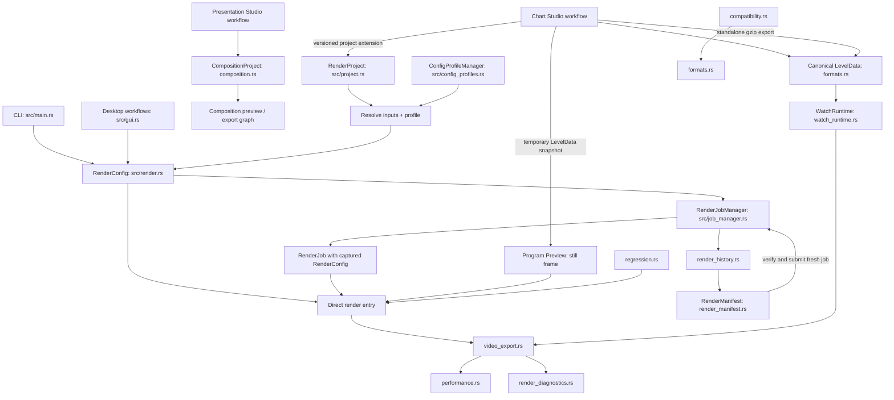
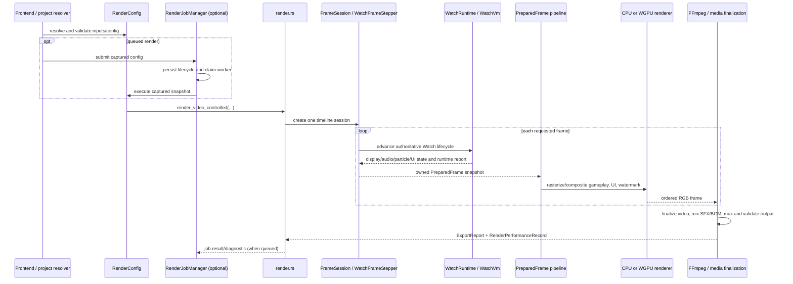

# Sono-Renderer architecture

This guide describes the current implementation in the single `renderer`
Cargo package. It is a map of code that exists today, not a target design.
Feature-specific behavior and CLI usage remain in the guides linked from the
[README documentation index](../README.md#documentation).
The current shared-platform versus domain-specific boundaries are summarized
in [General platform architecture](GENERAL_PLATFORM_ARCHITECTURE.md).

## Entry points and ownership

`src/lib.rs` exposes the renderer and subsystem modules. `src/main.rs` owns
the Clap command tree, command orchestration, and desktop launch. `src/gui.rs`
owns the eframe desktop frontend. Both frontends call the same library
configuration, project, queue, render, and persistence code; the GUI does not
have a second Watch evaluator or renderer.

The desktop shell persists a `WorkflowId` route separately from `WorkspaceId`
panel-layout preferences. Its default navigation, palette, and shortcut editor
register Home, Quick Render, Production, Tools, Settings, and Diagnostics.
Chart Studio and Presentation Studio routes, documents, and services remain in
the source, but are omitted from default UI registration; saved editor routes
fall back to Quick Render at startup. The complete workflow IDs, command IDs,
and document formats remain intact. `Desktop::ui` still contains the retained
surfaces for a future interface to register. Presentation Studio's Editing and
Voiceover layouts only change panel visibility and timeline dimensions. The
[workspace guide](WORKSPACE_COMMANDS.md) describes the current registration
boundary and its customization limits.

The desktop frontend is native Rust `eframe`/`egui`. The separate React/Vite
client in `web/` is an administration console served by the optional Rust Axum
service; it consumes service DTOs and does not implement another renderer or
desktop workflow.



| Concept | Authoritative representation | Owner and role |
|---|---|---|
| Sonolus LevelData | `LevelData` / `LevelEntity` | `formats.rs`; import, canonical semantic representation, bounded authoring loader, and standalone serialization |
| Editable chart | `ChartDocument` | `chart_studio.rs`; edits canonical LevelData with source/dirty state and bounded chart-local undo history |
| Engine authoring metadata | `AuthoringSchema` | `chart_studio.rs`; optional declarative, engine-content-bound labels and property hints; never required to load/render a level |
| Reusable render subject | `RenderProject` | `project.rs`; file references, metadata, subject overrides, profile reference, output defaults |
| Standalone video edit | `CompositionProject` | `composition.rs`; media references, tracks, clips, effects, animation, preview/export state |
| Reusable renderer preferences | `ConfigProfile` containing `RenderConfig` | `config_profiles.rs`; catalog and active selection |
| Resolved request | `RenderConfig` | `render.rs`; validated inputs, output, visual/audio configuration, backend, execution mode, and captured scheduler settings |
| Queued execution snapshot | `RenderJob` | `job_manager.rs`; immutable-in-practice config snapshot plus mutable lifecycle/progress fields |
| Export result | `ExportReport` and `RenderJobOutcome` | `video_export.rs` and `job_manager.rs`; completed output and execution summary |
| Watch graph | `WatchData` / `EngineNode` | `watch.rs`; deserialized graph and node data |
| Watch evaluator | `WatchVm` | `runtime.rs`; operation semantics and memory model |
| Watch lifecycle | `WatchRuntime` | `watch_runtime.rs`; entity lifecycle, callbacks, audio/draw/particle commands, and scheduling |
| Frame/timeline session | `FrameSession`, `WatchFrameStepper`, `PreparedFrame` | `offline.rs`; authoritative frame progression and owned per-frame snapshots |
| Optional native execution mode | `WatchExecutionMode`, `SonoGccProgram` | `sono_gcc.rs`; eligible scalar regions with Watch VM as semantic oracle/fallback |
| Render telemetry | `RenderPerformanceRecord` | `performance.rs`; timing, stage semantics, backend/cache observations, workload and environment identity |
| Render explanation | `RenderDiagnosticRecord` | `render_diagnostics.rs`; findings and references to authoritative performance data |
| Compatibility result | compatibility report | `compatibility.rs`; static analysis and optional dynamic probe using the existing Watch runtime |
| Cached native artifacts | exact-graph cache identity and manifest | `sono_gcc.rs`; code-generation/cache correctness; `cache_manager.rs` inventories and safely manages entries |
| Historical attempt | `RenderHistoryRecord` | `render_history.rs`; one durable, sanitized terminal-attempt record |
| Portable reproduction record | `RenderManifest` | `render_manifest.rs`; content-identified snapshot exported from history and verified before submitting a new job |
| Notification event | `RendererEvent` | `notifications.rs`; auxiliary delivery payload derived from renderer/job events |

The only concrete queue/history and renderer/config source cycles found in
this pass were accidental type/path dependencies. `job_manager.rs` now owns
the projection from a terminal `RenderJob` into `RenderHistoryRecord`, while
`render_history.rs` owns validation and persistence. Queue/history default
paths are resolved by the private `store_paths` module. `JobPriority` and
`JobManagerConfig` live in private `job_config.rs`; `job_manager` re-exports
their former public paths, so existing Rust references and serialized values
are preserved. The renderer no longer imports queue implementation code just
to name scheduler settings.

Other relationships are direct producer/consumer dependencies rather than
cycles: diagnostics consume performance records; regression drives the real
render entry point; projects use the job manager only when submitting work.
The broad `RenderConfig` type still carries both render and scheduler settings
for shared configuration compatibility. Renderer execution and performance
record construction also share `render.rs`/`performance.rs` types. Those are
intentional current couplings; breaking them would require a larger request
model conversion and is outside a behavior-preserving debt pass.

## Render and Watch path

Direct CLI/GUI rendering and queued jobs converge on `RenderConfig`. A project
first resolves relative input paths, profile selection, and project overrides
into that same config. The queue stores the captured config before a worker
starts, so later edits to a project or profile do not alter an already
submitted job.



`formats.rs` detects and loads engine packages, level data, skins, and resource
manifests. It uses package contents and metadata where available; filename
extensions are not the authority for SCP payload structure. `offline.rs`
owns timeline stepping. `WatchFrameStepper` advances the same `WatchRuntime`
which constructs callbacks and invokes `WatchVm`. The report and owned
`PreparedFrame` snapshot feed rendering, UI, particles, and audio collection;
the pipeline consumer does not run Watch.

The chart renderer executes `EngineWatchData`. `EnginePlayData` is retained
for declarations and analysis; the application does not implement the
Sonolus client's interactive Play or Preview modes. **Program Preview** is a
still-frame render through this Watch and compositor path.

This is the “one Watch” invariant: ordinary export playback executes one
`FrameSession` traversal. Whole-chart discovery is a bounded preflight for
schedule/end evidence and does not run playback frames. Explicit determinism
validation is intentionally two rendered traversals. Regression capture and
compatibility dynamic probes invoke the same Watch runtime/evaluator; neither
contains a parallel operation interpreter. The old event-only audio profiling
accumulator is now test-only, and the production profile no longer exposes
retired event-only counters as mutable state.

`WatchData` deserializes the optional `entityMemoryLength`,
`entityDataLength`, and `entitySharedMemoryLength` fields with defaults of
64/32/32. `WatchRuntime` applies them to Entity Memory bounds, per-entity
Entity Data and Shared Memory row strides, imports, and spawned-entity memory
payloads. Length conversions and dense-array size calculations are checked;
the renderer applies a 256 MiB allocation safeguard that is not a Sonolus
protocol limit. The 1.1.5 out-of-range read/write behavior is implemented from
static prototype findings and remains unverified against the APK at runtime.

`sono_gcc.rs` compiles only statically eligible scalar regions. Watch VM
evaluates runtime cuts, dynamic or effectful nodes, and every unsupported
operation. A failed/unready native path falls back according to the selected
mode and compatibility rules. Cache identity includes the exact graph and
compiler/runtime identity; `cache_manager.rs` may inspect or remove generated
entries but does not define semantic equivalence.

Chart Studio does not introduce an editor-only level graph: its
`ChartDocument` owns the canonical `formats::LevelData`. The optional
`AuthoringSchema` describes labels and safe property widgets for one exact
engine content identity; it does not change import, Watch, or export
semantics. A project stores the editable chart snapshot under a versioned
extension key in the existing `RenderProject`. Export writes ordinary
standalone gzip LevelData, which the normal renderer can load without the
project, schema, cache, or Chart Studio. The Chart Studio preview exports an
immutable temporary snapshot and invokes the same `RenderConfig::render_frame`
entry used by Program Preview. Program Preview itself is a still-frame monitor.
Presentation Studio is a separate standalone NLE boundary: `composition.rs`
owns the versioned `CompositionProject` and its media, track, clip, effect,
transition, and keyframe semantics. The GUI captures immutable project
snapshots for preview, proxy, and export workers. Those paths use the
composition FFmpeg graph and `timeline_playback.rs`; they do not load
`RenderConfig`, an engine, LevelData, Watch, or Sono-GCC. Continuous preview
streams decoded video against the CPAL output-sample playback clock; still-frame
preview and MP4 export use the same composition graph. The source monitor
renders a selected media source independently of the program playhead. Project
persistence, media relinking, nested composition validation, and recovery
remain owned by the composition subsystem. See
[Presentation Studio](PRESENTATION_STUDIO.md).

## Video, audio, visual layers, and output

`video_export.rs` coordinates frame production, bounded handoff, rendering,
profiling, stage timing, audio preparation, muxing, and final validation.
`gpu_render.rs` contains the CPU and WGPU draw/composition implementations.
`render_ui.rs` composes configured gameplay UI; `particles.rs` evaluates and
draws particle effects; `watermark.rs` composes fixed and moving marks. BGM/MV
media preparation is in `export_media.rs`/`export_mv.rs`; SFX decode and mixing
is in `audio.rs`. `ffmpeg.rs` resolves a validated FFmpeg/FFprobe pair and
`video_export.rs` owns the render's subprocess lifetime and staged output
publication.

The bounded export producer can overlap Watch/CPU frame preparation with
downstream work. `PreparedFrame` owns data needed after Watch advances. Stage
records explicitly distinguish disjoint export-phase wall spans from nested
or concurrent attribution; producer blocking, queue residence, and worker
busy time are not additive render phases. For interpretation rules, see the
[Performance Laboratory guide](PERFORMANCE_LAB.md).

### Time ownership

The engine's Watch clock is the gameplay clock. The LevelData `bgmOffset`
defines one source-media mapping:

```text
media_time = watch_time + bgmOffset
watch_time = media_time - bgmOffset
output_time = watch_time - aligned_watch_start
```

`export_timeline.rs` owns the shared forward and inverse media-clock
conversions. `ExportTimeline` additionally maps output-relative time to the
aligned Watch frame grid and audio sample range. `offline::audio_window`,
whole-chart audio bounds, MV sampling, and Chart Studio media-time seeking use
that same offset convention. Beat/time conversion remains the engine's Watch
operation; Chart Studio only treats fields as time when an optional schema
explicitly declares their unit. Chart Studio may save a separately accepted
media-time reference grid in the render-project extension. It does not alter
LevelData or introduce universal beat conversion/snapping semantics.

## Persistence and schema ownership

Each format has one loader/validator/migrator/writer owner. Files remain small
records or references; output videos and large regression images are stored
separately.

| Data | Owner | Current format/schema | Save/recovery behavior |
|---|---|---|---|
| Render settings | `render.rs` | `sono-renderer-config`, schema 1; markerless legacy shape accepted | same-directory atomic replacement |
| Projects and recent list | `project.rs` | project schema 1; recents schema 1 | project atomic save; bounded recent list |
| Chart Studio project extension | project envelope in `project.rs`; snapshot codec in `chart_studio.rs` | extension wrapper schema 1; canonical LevelData payload | stored in the existing project `extra` map and written with the project's atomic save; unknown sibling extension keys are retained |
| Profile catalog/export | `config_profiles.rs` | schema 1 | sanitized export and atomic catalog persistence |
| Gameplay UI profile | `render_ui.rs` | schema 1 | profile validation and file persistence |
| Watermark profile | `watermark.rs` | schema 1 | profile validation and file persistence |
| Job queue | `job_manager.rs` | queue store version 1 | store lock, merge, validate output reservations, atomic replacement; active-job recovery on open |
| Render history | `render_history.rs` | record and retention schema 1, one JSON file per attempt | atomic per-record publication, corruption reported per entry, retention separate from queue |
| Reproducible render manifest | `render_manifest.rs` | `sono-render-manifest`, schema 1 | bounded JSON; canonical SHA-256; same-directory atomic no-clobber publication; relative path hints; unknown fields retained |
| Performance records | `performance.rs` | schema 1, one JSON file per record | bounded retention; benchmark reports are separate exports |
| Diagnostic records | `render_diagnostics.rs` | schema 1 | atomic individual records and bounded retention |
| Regression references | `regression.rs` | schema 1 | explicit capture/replace and retained image artifacts |
| Sono-GCC cache manifest | `sono_gcc.rs` | manifest v4 | exact-key validation, bounded payload checks and atomic publication |
| Notification settings | `notifications.rs` inside shared config | schema 1 | tolerant parse disables malformed optional config with a warning |
| Welcome/onboarding preferences | `onboarding.rs` | local preference schema 2; schema 1 migrates | atomic local save; completed users remain dismissed; no timer-based reappearance |
| Presentation composition | `composition.rs` | `.sonocomp` schema 21 | atomic project save, project-relative media references where possible, separate bounded recovery checkpoints |

Default queue/history paths are centralized in `store_paths.rs`; explicit
store arguments and the existing `SONO_RENDERER_JOB_STORE` and
`SONO_RENDERER_HISTORY_DIR` overrides remain supported. The detailed storage
location and migration policies are in the individual guides. The cache
manager does not own settings, profiles, projects, queue/history, outputs, or
regression artifacts.

Manifests are derived from immutable history snapshots. Their verification
uses SHA-256 content identities and current config validation; reproduction
creates a new queue job and records manifest/history lineage in new history.
The manifest module does not own another renderer, history store, cache, or
job lifecycle. See the [render manifest guide](RENDER_MANIFESTS.md).

Two project formats intentionally serve different workspaces. `RenderProject`
stores Sonolus render inputs and defaults; Chart Studio can persist its authored
LevelData through a versioned extension in that envelope. `CompositionProject`
is the standalone Presentation Studio NLE document and stores media references,
tracks, clips, effects, transitions, and keyframes without requiring a
`RenderProject`, `RenderConfig`, engine, or Watch runtime. They have distinct
open/save controls and formats. The existing Recent Projects store covers
render projects; compositions do not yet have a separate recent-composition
catalog. Profiles remain reusable render settings, jobs capture resolved
configuration, history records attempts, and manifests describe reproducible
render inputs/outputs.

## Background work, synchronization, and shutdown

- **Render job workers** are owned by `RenderJobManager`. `open` recovers the
  persistent queue; workers start with the manager, use a shared state mutex
  and condition variable to claim work, and are cancelled and joined when the
  manager drops. The persisted maximum is bounded at eight; the default is
  one. A worker calls the ordinary renderer using its captured job config.
- **Watch parallel callback workers** are owned by one `WatchRuntime` pool.
  Each worker receives a bounded-channel batch, returns owned callback
  results, and is joined when the runtime drops. The caller sorts/commits
  results by callback task index to preserve lifecycle order. Failures and
  unexpected shared writes stop the speculative suffix and preserve ordered
  fallback behavior.
- **The export pipeline** owns bounded frame channels and the encoder child.
  Cancellation is carried by `ExportControl`; producer/consumer errors cancel
  the handoff and staged output is not published as the final path.
- **GUI workers** are frontend-owned threads for direct export and selected
  background work such as compiler preparation. The GUI polls results and
  progress; its live-state mutex protects UI snapshots, not render execution.
- **Notifications** use one lazily initialized, bounded worker. `emit` uses
  non-blocking `try_send`; a full queue can discard a newest auxiliary event.
  Delivery failure cannot fail a render. Network/platform delivery stays on
  the worker.
- **Sono-GCC** uses a short-lived process-cache mutex for lookup, keyed compile
  gates for duplicate work, and disk entry locks for shared artifacts. Native
  compilation does not run under the global process-cache mutex.
- **FFmpeg and rustc** are child processes managed by their owning export or
  compiler paths; the export cancellation path terminates/reaps its encoder.

Lock review found queue state serialization as the broadest critical section:
queue mutations and synchronous atomic queue writes occur under its state
mutex so process-local state and the persisted merge remain coherent. Render,
compiler work, history publication, and notification delivery happen after
that queue guard is released. Queue persistence takes the on-disk store lock
after the in-process state lock. No global lock-order contract exists for all
subsystems; new code should avoid nested application mutexes and must not hold
the queue state lock across rendering, native compilation, or network calls.
Progress persistence is rate-limited rather than written for every frame.

## Errors, unsafe code, and platform boundaries

Boundary-facing loaders and persistence functions return `anyhow::Result`
with path/operation context; schema/status/diagnostic concepts use typed enums
where callers branch on them. Job failure kinds and diagnostic findings retain
structured categories while logs/errors keep the underlying chain for
inspection. The renderer generally fails a malformed required input rather
than treating a parse error as a successful no-op. Notification delivery is
the deliberate best-effort exception.

Unsafe Rust is limited to a few explicit boundaries:

- `sono_gcc.rs`: Windows DLL load/symbol lookup and invocation through a
  generated C ABI function pointer. The generated entry checks the exact input
  length and rejects a null pointer for nonempty input before constructing a
  slice. `NativeLibrary` owns the module handle and unloads it after all
  regions retaining the function pointer are dropped. The ABI assumes
  generated code and caller were built for the same Windows process ABI.
- `job_manager.rs`: Windows `OpenProcess`/`CloseHandle` or Unix `kill(pid, 0)`
  checks whether a persisted worker PID is still live; a failed query does
  not mark an interrupted attempt completed.
- `gui.rs`: Windows `FreeConsole` during GUI startup.

GPU work uses safe WGPU interfaces. FFmpeg is called through `std::process`
and validated executable paths, not FFI. Platform-specific executable names,
notifications, PID checks, console behavior, and open/reveal actions are kept
in their owning adapters. This checkout's full validation ran on Windows
x86_64/MSVC only; Linux/macOS compilation and runtime behavior are not
verified in this pass.

## Tests, dependencies, and performance discipline

Tests are organized by where their evidence comes from rather than forced
into one large suite:

- **Semantic/unit:** module-local Watch operation, memory, parsing, config,
  serialization, state-transition, image, and audio invariants.
- **Subsystem/integration:** `tests/arctan2.rs`, `tests/watch_scheduler.rs`,
  and `tests/m0.rs` cross actual Watch/runtime/loader/render boundaries with
  supplied fixtures.
- **Real-engine:** supplied Next Rush/Next Sekai assets and the corpus tests;
  four opt-in corpus/forensic cases remain ignored in the default suite.
- **Regression:** the versioned `regression-fixtures` and saved Regression Lab
  reference compare pixels, semantic layers, audio, and timing separately.
- **Performance:** the Performance Laboratory repeats real renders and stores
  distributions; ordinary correctness tests have no wall-time threshold.

Names such as `watch_draw_negative_one_is_oracle_verified_noop_and_execution_continues`,
`master_off_leaves_both_compositor_stages_pixel_identical`,
`exact_graph_cache_identity_changes_when_watch_values_change`, and
`history_rerender_cli_submits_a_new_queue_job_from_the_saved_snapshot` state
the invariant each test guards. Do not remove these tests as “implementation
details” without retaining the corresponding behavior check.

The direct dependencies in `Cargo.toml` are used by current modules. The
offline Cargo duplicate-tree inspection found duplicate versions primarily
under GUI/GPU dependencies (`eframe`, `wgpu`, windowing and graphics stacks),
not redundant direct dependencies with a clear safe replacement. `cargo
machete` is unavailable in the installed toolchain. No dependency was upgraded
or removed in this pass.

Allocation review found deliberate ownership boundaries: `PreparedFrame`
retains a frame's report and presentation snapshot after Watch advances;
bounded pipeline handoff transfers that owned frame; queue submission captures
config so later UI/profile mutation cannot affect it; GPU upload/readback and
FFmpeg buffers are required backend/process boundaries. This pass made no
performance-motivated allocator or copy changes. See the paired baseline and
post-cleanup measurements in the
[Follow-up #21 report](reports/follow-ups/SONO_RENDERER_FOLLOWUP_21_MAINTAINABILITY_REPORT.md).

## Behavior invariants and freeze boundary

The following are freeze-level behavior contracts:

1. **Sono VM defines semantics.** Sono-GCC may execute only its eligible
   scalar subset; cuts, unsafe or unsupported operations, and fallback must
   preserve VM behavior.
2. **One Watch playback path.** Export, diagnostics, and regression consume
   `WatchRuntime`/`WatchVm`; ordinary audio/event collection must not create a
   second playback traversal.
3. **A submitted job uses its captured `RenderConfig`.** Later project,
   profile, or GUI edits do not mutate pending/running work.
4. **Cache correctness outranks hit rate.** Exact identity and validation are
   prerequisites for reusing native artifacts.
5. **The direct workflow stays optional-subsystem-free.** Engine + resources +
   level + optional music can render without a project, profile catalog,
   queue/history, notifications, diagnostics browser, or regression lab.
6. **Presentation layers do not mutate VM semantics.** Gameplay UI,
   particles, watermark, and media compositing consume runtime results.
7. **History records attempts; it does not schedule them.** Render Again
   creates a fresh job and a fresh history result.
8. **Notification failure cannot fail rendering.** Delivery is bounded and
   best-effort.
9. **Output publication is transactional at the renderer boundary.** Staged
   media is validated before publication; a failed export must not present a
   partial file as a completed output.
10. **Watermark master-off dominates moving watermark.** A disabled master
    switch must leave both watermark stages inactive.
11. **Performance spans have explicit meaning.** Queue wait is not execution;
    inclusive/nested attribution and overlapping workers are not summed into
    disjoint wall time.
12. **Persistent formats are owned and versioned.** Unknown/future versions
    are rejected or isolated explicitly; markerless legacy config remains
    accepted only on its documented compatibility path.

For the next stable release, freeze the boundaries in the ownership table,
the listed schema versions and migration behavior, current direct CLI input
semantics, shared `RenderConfig` field meanings, job snapshot semantics, and
the twelve invariants above. New work should extend those seams. It should not
add another Watch evaluator, a second timing model, or another writer for an
existing store.
